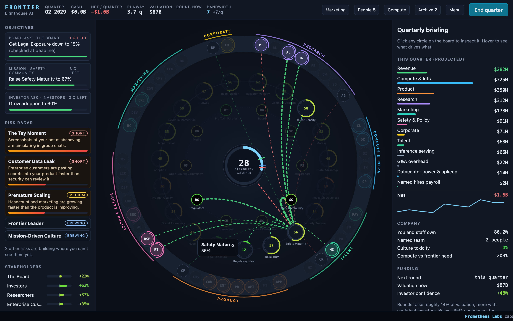
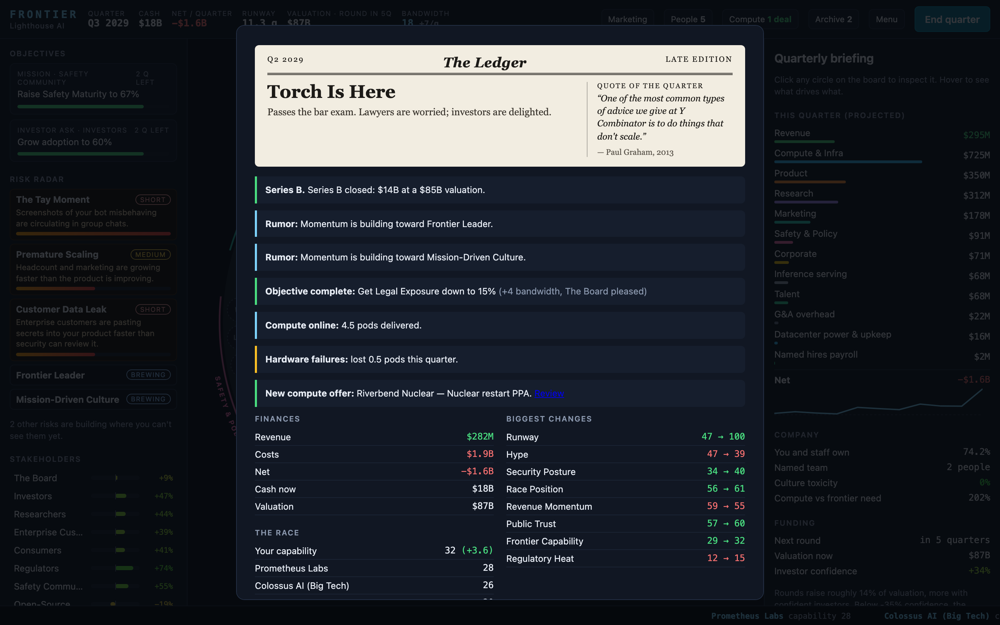

# Frontier

**Found an AI lab. Race to AGI. Try not to repeat history.**
**[Play in your browser →](https://g8r-b8.github.io/frontierLab/)**



A Democracy-style management sim about founding a frontier AI lab. It has the same structure as
Positech's *Democracy*: policies on sliders, a web of lagged cause and effect, stakeholder
"voter groups", situations and dilemmas. The difference is that you're racing to AGI instead of
running a country, and history keeps repeating on you.

## Play

Play online at https://g8r-b8.github.io/frontierLab/, or locally:

```sh
open index.html          # just play (no build step, autosaves locally)
npm start                # or: serve at http://localhost:4747 with the terminal bridge
./frontier help          # drive the open game from a terminal (needs npm start)
```

Ask Claude Code to be your chief of staff while you play. `CLAUDE.md` tells it how to read the
live game through `./frontier status --json`, explain what's driving things, and post advice
into the game's advisor panel with `./frontier say`.

## What's in it

| Democracy            | Frontier                                                             |
|----------------------|----------------------------------------------------------------------|
| Political capital    | Bandwidth (leadership attention)                                     |
| Policies & sliders   | 44 policies in 7 categories (incl. Marketing)                        |
| Simulation values    | 16 stats + 4 indicators, all wired together with lags                |
| Voter groups         | 10 stakeholders (board, investors, researchers, regulators, ...)     |
| Elections            | Funding rounds every 6 quarters, plus dilution                       |
| Assassination        | Board coup                                                           |
| Situations           | 13 situations (talent exodus, injunctions, viral moments, ...)       |
| Dilemmas             | 32 events incl. real AI bloopers, plus a launch-day call per model   |
| Cabinet              | Hiring: named candidates, hiring managers, practices, culture values |
| —                    | GPU fleet: chip generations, failures, depreciation, power, deals    |
| —                    | 18 historical pitfalls across short, medium and long horizons         |
| —                    | 171 verified real quotes/artifacts on the loading screen, in the newspaper and in the Archive; 78 achievements |
| —                    | Marketing: brand vs hype, campaigns (Super Bowl in Q1 only), launch strategy |
| —                    | Multiplayer: real-time, peer to peer, friends + AI labs, chat        |
| —                    | Plague Inc-style growth map; world events hitting all, some or random labs |
| —                    | Cookie Clicker-style golden opportunities, buffs, Legacy prestige perks, joke ticker |
| —                    | Rival moves: poach, price war, espionage, smears, pacts, licensing, acquisitions — and rivals that do it to you |
| —                    | Startup scorecard: Blitzscaling stages, YC weekly growth bar, PMF, burn multiple, default alive |
| —                    | Growth Playbook: commit to Blitzscaling rules or YC maxims (embrace chaos, founder mode, talk to users...) |

It runs in **real time**: the clock never stops for you, decisions expire, and you never see the
whole picture. Rivals are estimates, your own safety is an eval estimate, and every run has a hidden
world with its own rules. There are three difficulties: **Easy**, **Normal** and **Realistic**.



Real people and events appear only as sourced archive cards and history notes on pitfalls.
The verified research lives in `tools/research/`. The labs, chips and providers you meet in
play are fictional.

## Layout

- `js/data/*.js`: content and tuning. `archive.js` and `achievements.js` are generated by
  `python3 tools/build_archive.py`.
- `js/engine.js`: the core simulation. `js/systems.js` handles pitfalls, the archive, objectives,
  eras and the director. `js/hardware.js` is the GPU fleet and `js/hiring.js` is recruiting and
  culture.
- `js/ui.js`, `js/audio.js`, `js/fx.js`: board, panels, synthesized sound and feedback.
- `tools/serve.js`, `js/bridge.js`, `cli/frontier.js`: the terminal bridge.
- `tools/simulate.js`: headless balance bots (`npm run sim`, `DIFFICULTY=realistic npm run sim`).
- `js/net.js`, `js/multiplayer.js`: peer-to-peer lobbies and the shared real-time race (`docs/MULTIPLAYER.md`).
- `test/`: `npm test`.

Roadmap: [TODO.md](TODO.md). Docs: [docs/](docs/). Press kit: [docs/PRESS_KIT.md](docs/PRESS_KIT.md).

## License

[Apache License 2.0](LICENSE). Fork it, remix it, ship it — but keep the [NOTICE](NOTICE) file and credit the
original project ([g8r-b8/frontierLab](https://github.com/g8r-b8/frontierLab)), and say what you changed.
Real quotes and facts in the Archive belong to their original authors and are cited with sources.
